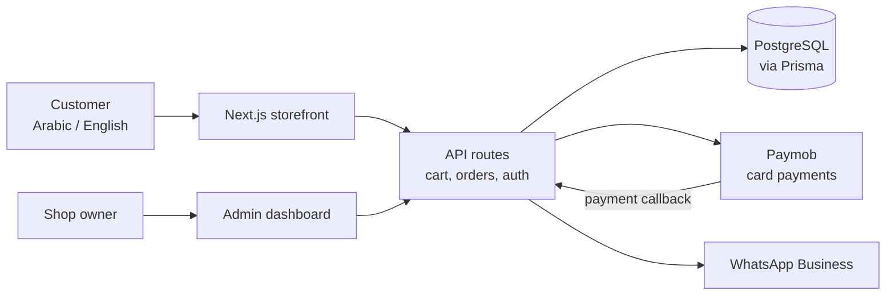

# Al Anoud Optics — Bilingual E-commerce Store

A full online store for **Al Anoud Optics** (نظارات العنود), an eyewear shop in Egypt, built as a freelance project. Customers can browse sunglasses, prescription glasses, frames and contact lenses in **Arabic or English**, order online, pay by card or cash on delivery, and track their orders. The shop owner runs the business from a protected admin dashboard.

> The source code is kept in a private repository because it belongs to the client. This page describes the project, its features and how it is built. Code walkthroughs are available on request.

**Status:** in development · 21 pages · 18 data models · 16 automated test suites plus end-to-end checkout and payment tests

---

## Features

| Area | What it does |
| --- | --- |
| Storefront | Arabic (right-to-left) and English versions, responsive on mobile, product catalog with search, filters and sorting |
| Products | Variants (colour, size), stock levels, sale prices, specifications, reviews and related products |
| Signature product | An interactive configurator for the store's signature rimless frame |
| Cart & checkout | Persistent cart, delivery or in-store pickup, discount codes, Egyptian phone and address validation |
| Payments | Card payments through **Paymob** and cash on delivery; the secret key never reaches the browser |
| Orders | Customer accounts, order history and order tracking by order number and phone |
| WhatsApp | Order messages and a WhatsApp Business webhook for customer conversations |
| Admin dashboard | Products, categories, brands, stock adjustments, orders, discount codes, store settings and 30-day sales reports |
| Security | Hashed passwords, signed HTTP-only sessions, role-based admin access, rate limiting, input validation and an audit log of stock changes |
| SEO | Page metadata, sitemap and robots rules for both languages |

## How it works

- **Stock is safe under load:** stock is locked while an order is placed and given back if a payment fails or expires, so two customers can never buy the last item.
- **Payments are verified on the server:** an order is marked paid only after Paymob's signed callback is checked.
- **Two languages, not a translation layer:** the Arabic store has its own right-to-left layout, fonts and line breaks.

## Built with

Next.js · React · TypeScript · Tailwind CSS · PostgreSQL · Prisma · Zod · Paymob API · WhatsApp Business Cloud API · Node test runner

Developed with AI coding tools (Claude Code, Codex) under my direction: I set the requirements and design direction, reviewed each step and tested the purchase and payment flows.

## Author

**Mostafa Khalaf** — IT Help Desk Engineer / Junior Network Administrator
[sas8089@icloud.com](mailto:sas8089@icloud.com) · [github.com/sasa8089-collab](https://github.com/sasa8089-collab)
